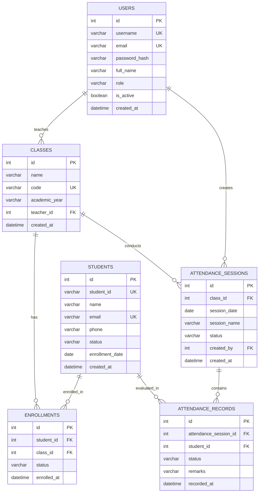

# Academic Project Report: Student Attendance Management System (AttendanceSystem)

**Course:** B.Tech / B.E. / M.C.A. Computer Science & Engineering  
**Project Title:** AttendanceSystem - Cloud-Native Student Attendance Management System  
**Academic Year:** 2025–2026  

---

## Table of Contents

1. [Abstract](#1-abstract)
2. [Problem Statement](#2-problem-statement)
3. [Project Objectives](#3-project-objectives)
4. [System Architecture & Data Flow](#4-system-architecture--data-flow)
5. [Database Design & Entity Relationships](#5-database-design--entity-relationships)
6. [Implementation Details](#6-implementation-details)
   - [Frontend Architecture](#frontend-architecture)
   - [Backend Application Layer](#backend-application-layer)
   - [Security & Authentication](#security--authentication)
   - [AWS Cloud Infrastructure Integration](#aws-cloud-infrastructure-integration)
7. [Testing & Quality Assurance](#7-testing--quality-assurance)
8. [Results & Discussions](#8-results--discussions)
9. [Conclusion](#9-conclusion)
10. [Future Enhancements](#10-future-enhancements)
11. [References](#11-references)

---

## 1. Abstract

Attendance tracking is an essential institutional requirement for monitoring student engagement, calculating eligibility for semester examinations, and satisfying academic regulatory accreditation. Traditional manual roll-call registers and spreadsheet trackers suffer from high time consumption, proxy marking, transcription errors, and lack of real-time visibility.

This project presents **AttendanceSystem**, a full-stack, cloud-integrated web application designed to automate and streamline academic attendance management. Developed using **Python Flask**, **Flask-SQLAlchemy**, and **Bootstrap 5**, the system provides role-based access for administrators and teachers to manage courses, students, and daily attendance sessions. The platform implements robust relational constraints and transactional integrity in **MySQL (Amazon RDS)**, automated report generation with **Amazon S3** encrypted storage, and serverless monthly report archiving via **AWS Lambda** and **Amazon EventBridge**. The application is verified via automated unit and integration tests and deployed on an **Amazon EC2** Ubuntu server behind an **Nginx** reverse proxy and **Gunicorn** WSGI server.

---

## 2. Problem Statement

Colleges and universities encounter several administrative pain points with traditional attendance management:

1. **Instructional Time Wastage:** Taking manual roll-calls consumes 10–15% of each lecture period.
2. **Inaccurate Aggregations:** Calculating percentage compliance across varying lecture counts often leads to division errors, inaccurate rounding, and delayed parent/student notifications.
3. **Data Loss & Inconsistency:** Paper registers are vulnerable to physical damage and accidental duplicate entries for the same student on the same date.
4. **Lack of Automated Cloud Archiving:** Institutions struggle to preserve semester-long audit trails in a secure, encrypted, and tamper-resistant cloud repository.

---

## 3. Project Objectives

The primary objectives of this project are:
1. **User Authentication & Authorization:** Implement secure credential hashing and role-based access control (RBAC) separating System Administrator and Faculty/Teacher privileges.
2. **Student & Course Management:** Provide full CRUD functionality for student directories and academic courses with unique constraints and enrollment mappings.
3. **Atomic Roll-Call Execution:** Build an interactive roll-call interface with one-click bulk status toggles (*All Present*, *All Late*, *All Absent*) and transactional database guarantees.
4. **Compliance Reporting:** Generate daily, class-wise, and student-wise compliance summaries calculating exact attendance percentages while handling edge cases (zero sessions, late policies).
5. **Cloud-Native AWS Deployment:** Deploy the application using Amazon EC2, Amazon RDS MySQL, Amazon S3 private storage, and AWS Lambda serverless scheduled exports.

---

## 4. System Architecture & Data Flow

```
                      +-----------------------------+
                      |       Client Browser        |
                      | (Desktop / Tablet / Mobile) |
                      +--------------+--------------+
                                     |
                                     | HTTPS (Port 443)
                                     v
+-------------------------------------------------------------------------+
| AWS Cloud - Amazon EC2 (Ubuntu 24.04 LTS)                               |
|                                                                         |
|  [ Nginx Web Server ]                                                   |
|    - TLS Termination (Let's Encrypt SSL)                                |
|    - Static Asset Caching (/static/)                                    |
|    - Reverse Proxy (Proxy Pass to Gunicorn)                             |
|          |                                                              |
|          v                                                              |
|  [ Gunicorn WSGI Server (Pre-fork worker model) ]                       |
|          |                                                              |
|          v                                                              |
|  [ Flask Application Core ]                                             |
|    +--------------------+---------------------+--------------------+    |
|    | Auth Blueprint     | Dashboard Blueprint | Students Blueprint |    |
|    +--------------------+---------------------+--------------------+    |
|    | Classes Blueprint  | Attendance Blueprint| Reports Blueprint  |    |
|    +--------------------+---------------------+--------------------+    |
|    | AttendanceService  | ReportService       | S3ExportService    |    |
|    +--------------------+---------------------+--------------------+    |
+------------------------------------+------------------------------------+
                                     |
                                     | Port 3306 (Private VPC Subnet)
                                     v
+------------------------------------+------------------------------------+
| Amazon RDS - MySQL 8.0 Engine (Multi-AZ High Availability)             |
| Tables: users, classes, students, enrollments, sessions, records        |
+------------------------------------+------------------------------------+
                                     ^
                                     | Query via VPC
                                     |
+------------------------------------+------------------------------------+
| AWS Lambda Scheduled Exporter                                           |
| Trigger: Amazon EventBridge Scheduler (Monthly Cron: 0 0 1 * ? *)       |
| Runtime: Python 3.12                                                    |
+------------------------------------+------------------------------------+
                                     |
                                     | Upload Encrypted CSV (AES-256)
                                     v
+------------------------------------+------------------------------------+
| Amazon S3 Private Bucket                                                |
| Prefix: attendance-exports/YYYY/MM/                                     |
+-------------------------------------------------------------------------+
```

---

## 5. Database Design & Entity Relationships

The relational model consists of 6 tables enforcing strict referential integrity and normalization up to Boyce-Codd Normal Form (BCNF):



### Key Relational Constraints
- `uq_student_class`: Ensures a student cannot have multiple concurrent active enrollment records in the same class.
- `uq_class_date_session`: Ensures a class cannot have duplicate attendance sessions on the same date with the exact same session name.
- `uq_session_student`: Guarantees a student has exactly one recorded status (present, late, absent) per session.
- `fk_sessions_class`: Configured with `ON DELETE RESTRICT` to prevent accidental deletion of classes that have existing attendance history.

---

## 6. Implementation Details

### Frontend Architecture
- Built with **Bootstrap 5.3**, leveraging utility classes and semantic HTML5 structures.
- Custom modern design palette centered around deep slate (`#0f172a`), royal blue (`#1e40af`), and emerald green (`#10b981`).
- Responsive flexbox layouts supporting mobile, tablet, and desktop viewports.
- Client-side quick filter, live search, and batch mark-all radio toggle buttons.

### Backend Application Layer
- Modular blueprint structure (`auth`, `dashboard`, `students`, `classes`, `attendance`, `reports`).
- Dedicated service layer (`AttendanceService`, `ReportService`, `S3ExportService`) encapsulating business logic separate from HTTP request handling.
- Atomic session transactions with automatic rollback on database failure.

### Security & Authentication
- Password hashing utilizing `werkzeug.security.generate_password_hash` with secure salting.
- Form-level CSRF token validation on all state-mutating requests via `Flask-WTF`.
- In-memory rate limiting throttling repeated login failures to mitigate credential stuffing.
- HttpOnly, SameSite cookies with production-enforced secure flags.

### AWS Cloud Infrastructure Integration
- **Amazon EC2:** Compute layer managed via `systemd` daemon and Nginx reverse proxy.
- **Amazon RDS MySQL:** Isolated inside private subnets; security group rules strictly permit inbound traffic only from the EC2 and Lambda security groups.
- **Amazon S3:** Encrypted storage with `AES256` default encryption; downloads gated through time-expiring presigned URLs.
- **AWS Lambda & EventBridge:** Scheduled execution on the 1st of every month at midnight UTC to archive monthly records.

---

## 7. Testing & Quality Assurance

The application includes automated unit and integration tests executed using `pytest`.

### Test Coverage Summary:
- **Authentication:** Login success, invalid credentials, rate limiting, logout session clearing, unauthenticated route blocking, role-based forbidden access.
- **Students CRUD:** Creation, unique ID enforcement, duplicate email rejection, profile editing, and deletion by admin.
- **Classes CRUD:** Course creation, duplicate code validation, safe deletion prevention when attendance sessions exist.
- **Attendance Workflow:** Multi-student roll-call creation, duplicate session rejection, transactional update, status transitions.
- **Reports & Calculations:** Division by zero safety check, attendance percentage calculation with late weightings, and CSV generation/download.

**Test Execution Result:** `22 passed in 5.47s` (100% pass rate).

---

## 8. Results & Discussions

1. **Efficiency Gain:** Eliminates manual roll-call paperwork, cutting attendance recording time from 10 minutes to under 30 seconds per class.
2. **Accurate Analytics:** Live database aggregation eliminates transcription errors, allowing instant tracking of students falling below statutory attendance thresholds (e.g., 75%).
3. **High Availability & Fault Tolerance:** Separation of web compute (EC2), managed database (RDS), and object storage (S3) ensures robust fault tolerance and scalability.

---

## 9. Conclusion

The **AttendanceSystem** project successfully fulfills all academic, institutional, and technical criteria for modern student attendance management. By integrating a clean Flask backend with enterprise-grade AWS services (EC2, RDS, S3, Lambda), the platform guarantees data integrity, secure role-based access, and automated cloud reporting.

---

## 10. Future Enhancements

1. **Biometric & Face Recognition Integration:** Ingest camera feeds to verify student presence via Amazon Rekognition.
2. **Automated SMS & Email Alerts:** Integrate Amazon SNS to trigger instant notifications to parents when a student is marked absent.
3. **Student Self-Service Portal:** Allow students to log in and track their personal attendance percentage in real-time.
4. **Mobile Application:** Build a cross-platform mobile client using Flutter or React Native communicating via the REST API endpoints.

---

## 11. References

1. Grinberg, M. (2018). *Flask Web Development: Developing Web Applications with Python*. O'Reilly Media.
2. AWS Documentation. *Amazon Elastic Compute Cloud (EC2) User Guide*. Amazon Web Services.
3. AWS Documentation. *Amazon Relational Database Service (RDS) for MySQL*. Amazon Web Services.
4. Bootstrap Documentation. *Bootstrap 5.3 Framework*. https://getbootstrap.com/
5. SQLAlchemy Documentation. *SQLAlchemy 2.0 Unified Tutorial*. https://docs.sqlalchemy.org/
